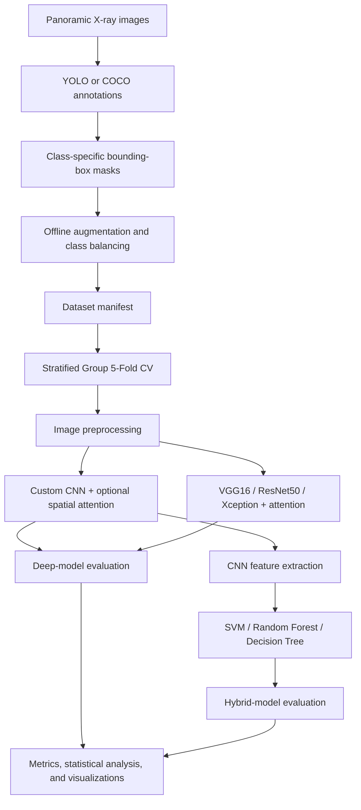

[README_Dental_Diagnosis.md](https://github.com/user-attachments/files/34879076/README_Dental_Diagnosis.md)
# Dental X-ray Diagnosis with Attention-Enhanced Deep Learning

A modular PyTorch implementation for classifying dental conditions in panoramic X-ray regions using a custom convolutional neural network, ImageNet-pretrained backbones, spatial attention, and hybrid deep-feature/classical-machine-learning models.

This repository provides the data-preparation pipeline, model definitions, training and cross-validation routines, feature extraction, evaluation, statistical comparison, visualization, and single-image inference.

> **Research implementation:** This codebase is an implementation scaffold based on the methodology described in the referenced paper. It should not be interpreted as a clinically validated diagnostic system or as a guarantee of an exact numerical reproduction of the published results.

---

## Table of Contents

- [Project Overview](#project-overview)
- [Implemented Pipeline](#implemented-pipeline)
- [Supported Classes and Task Formulation](#supported-classes-and-task-formulation)
- [Repository Structure](#repository-structure)
- [File-by-File Documentation](#file-by-file-documentation)
- [Installation](#installation)
- [Dataset Preparation](#dataset-preparation)
- [Running Experiments](#running-experiments)
- [Inference](#inference)
- [Outputs](#outputs)
- [Configuration](#configuration)
- [Evaluation and Statistical Analysis](#evaluation-and-statistical-analysis)
- [Implementation Notes and Reproducibility Considerations](#implementation-notes-and-reproducibility-considerations)
- [Limitations](#limitations)
- [Reference](#reference)

---

## Project Overview

The project investigates an attention-enhanced deep-learning workflow for identifying four dental-condition categories from annotated regions of panoramic dental radiographs.

The implementation contains three experimental tracks:

1. **Custom CNN:** a purpose-built convolutional neural network with an optional spatial-attention block.
2. **Transfer learning:** VGG16, ResNet50, and Xception backbones, combined with spatial attention and a task-specific classification head.
3. **Hybrid learning:** deep feature extraction from the custom CNN, followed by classical machine-learning classifiers:
   - Support Vector Machine (SVM)
   - Random Forest (RF)
   - Decision Tree (DT)

The code also supports experiments with and without the image-enhancement stage, allowing the effect of preprocessing to be examined.

### Main components

- YOLO and COCO bounding-box annotation readers
- Class-specific region masking
- Image enhancement and normalization
- Offline class balancing through geometric augmentation
- Stratified, group-aware five-fold cross-validation
- Attention-enhanced CNN architectures
- Transfer-learning models
- CNN feature extraction and hybrid classification
- Classification metrics, statistical tests, and plots
- Single-image prediction

---

## Implemented Pipeline

The repository is organized as a sequence of independent but connected modules.



### Processing stages

1. **Annotation parsing and region construction:** bounding boxes are read from YOLO text files or a COCO JSON file. For each original radiograph and each represented class, the annotated boxes of that class are combined into a rectangular mask. Pixels outside the mask are set to zero.
2. **Class balancing:** the generated samples are copied into a balanced dataset. Classes below the configured target are augmented using rotation and horizontal/vertical flips.
3. **Preprocessing:** during data loading, images can undergo brightness adjustment, CLAHE, resizing, and min–max normalization.
4. **Cross-validation:** samples are divided into five stratified folds while keeping samples derived from the same original radiograph in the same fold.
5. **Model training:** deep models are trained independently within each fold. For hybrid experiments, the CNN is trained first and its features are then used to fit classical classifiers.
6. **Evaluation:** fold-level metrics and predictions are saved, followed by aggregate summaries, statistical comparisons, and visualizations.

---

## Supported Classes and Task Formulation

The class order defined in `config.py` is:

| Class ID | Class |
|---:|---|
| 0 | Fillings |
| 1 | Cavity |
| 2 | Implant |
| 3 | Impacted Tooth |

The current neural-network implementation uses a four-logit classification layer, `CrossEntropyLoss` during training, and Softmax followed by `argmax` when converting predictions to class probabilities. Therefore, **each generated region is treated as one of four mutually exclusive classes**.

Although the referenced article uses the term *multi-label* in its title, the current implementation is a four-class, single-label classifier at the region/sample level. It is not a sigmoid-based multi-label model that independently predicts several conditions for one input.

The data builder may generate multiple class-specific samples from one original radiograph when that radiograph contains annotations from more than one class. These derived samples retain the same `original_image_id` for grouped cross-validation.

---

## Repository Structure

```text
dental_diagnosis_project/
│
├── attention.py
├── augmentation.py
├── config.py
├── cross_validation.py
├── custom_cnn.py
├── dataset.py
├── dataset_builder.py
├── evaluation.py
├── feature_extraction.py
├── hybrid_classifiers.py
├── inference.py
├── preprocessing.py
├── pretrained_models.py
├── run_experiments.py
├── statistical_analysis.py
├── train_deep_models.py
├── train_hybrid.py
├── utils.py
├── visualization.py
│
├── requirements.txt
└── README.md
```

The `data/` and `outputs/` directories are created at runtime. They are not included in the source archive. The dataset and trained model checkpoints must be supplied or generated separately.

---

## File-by-File Documentation

The modules are grouped below by their role in the pipeline. Every source and project file in the repository is documented.

### 1. Configuration and shared utilities

| File | Description |
|---|---|
| **`config.py`** | Central configuration module. Defines the four class names and their integer mapping, project/data/output paths, image size, random seed, five-fold CV setting, batch sizes, epoch limits, learning rates, scheduler and early-stopping parameters, preprocessing values, augmentation target, and classical-classifier hyperparameters. Change experiment settings here rather than scattering constants across modules. |
| **`utils.py`** | Shared utilities used throughout the project. Provides reproducibility seeding for Python, NumPy, and PyTorch; automatic CPU/CUDA device selection; directory creation; logging; manifest validation; JSON-safe serialization; JSON export; and model-checkpoint saving. It also checks that required manifest columns are present. |

### 2. Dataset construction and preparation

| File | Description |
|---|---|
| **`dataset_builder.py`** | Converts annotated panoramic radiographs into class-specific masked samples. Supports YOLO normalized bounding boxes and COCO absolute-coordinate bounding boxes. It maps supported annotation names to the canonical class names, combines boxes belonging to the same class, creates a rectangular mask, saves the masked image, and writes `manifest.csv`. This is bounding-box-based masking, not a learned segmentation model. |
| **`preprocessing.py`** | Implements the image-enhancement pipeline. When enabled, it applies brightness adjustment (`alpha=1.5`, `beta=15`) and CLAHE (`clipLimit=2.0`, `tileGridSize=(3,3)`). It then resizes the image to `128 × 128` using nearest-neighbor interpolation, applies per-image min–max normalization, and repeats the grayscale channel to produce a three-channel array. The enhancement stage can be disabled independently of resizing and normalization. |
| **`augmentation.py`** | Performs offline class balancing. It preserves each original sample, generates additional samples using random rotations within ±15 degrees and independently sampled horizontal and vertical flips, and writes a balanced manifest. The default target is 1,191 samples per class. The source `original_image_id` is retained for leakage-aware cross-validation. The current implementation raises an error if a class already exceeds the target; it does not downsample. |
| **`dataset.py`** | Defines the PyTorch `DentalXrayDataset` and DataLoader factory. It reads image paths and labels from a manifest, applies the configured preprocessing, converts images to channel-first PyTorch tensors, and returns integer labels. An optional metadata mode also returns the source-image group ID. |
| **`cross_validation.py`** | Builds stratified group-aware folds using `StratifiedGroupKFold` by default. All class-specific samples and augmented variants derived from the same `original_image_id` remain in one fold, preventing those related samples from appearing in both training and validation partitions. |

### 3. Deep-learning architectures

| File | Description |
|---|---|
| **`attention.py`** | Implements `SpatialAttentionBlock`. The feature map is reshaped into a spatial sequence, projected to attention scores, passed through `tanh` and a spatial Softmax, and reweighted by the resulting attention map. An optional return mode exposes the attention weights for inspection. |
| **`custom_cnn.py`** | Defines `CustomDentalCNN`, the repository's custom architecture. It contains three convolutional blocks with 64, 128, and 256 channels, ReLU activations, max pooling, and dropout. Spatial attention can be enabled or bypassed. The resulting feature map is flattened and passed through fully connected layers of 256 and 128 units before the four-class output layer. The model also exposes feature-map and feature-vector extraction methods for hybrid learning. |
| **`pretrained_models.py`** | Defines the transfer-learning architecture for VGG16, ResNet50, and Xception. The selected backbone produces a spatial feature map, which is processed by the attention block and global average pooling before the task-specific fully connected classifier. Most backbone parameters are frozen, while the final backbone block/stage is made trainable according to the implementation for each architecture. Xception is provided through `timm`. |

### 4. Hybrid deep-feature and classical-machine-learning models

| File | Description |
|---|---|
| **`feature_extraction.py`** | Extracts attention-enhanced CNN feature vectors from a DataLoader in evaluation mode and without gradient calculation. It returns feature arrays, labels, and optional source-image group IDs. It can save these arrays as compressed `.npz` bundles for subsequent analysis. |
| **`hybrid_classifiers.py`** | Builds Scikit-learn pipelines for SVM, Random Forest, and Decision Tree classification. Each pipeline includes a `StandardScaler` fitted on the training data when the classifier is trained. Random Forest uses 100 trees by default; SVM uses an RBF kernel by default. |
| **`train_hybrid.py`** | Implements the complete hybrid cross-validation workflow. Within each fold, it trains the custom CNN, extracts features separately from the training and validation partitions, fits SVM/RF/DT using training features only, and evaluates the resulting classifiers on the held-out fold. CNN checkpoints, feature bundles, fitted classifiers, metrics, and predictions are saved. |

### 5. Training, evaluation, and experiment orchestration

| File | Description |
|---|---|
| **`train_deep_models.py`** | Contains the deep-learning training engine. It builds the requested model, executes training and validation epochs, uses Adam and cross-entropy loss, adjusts the learning rate with `ReduceLROnPlateau`, and applies early stopping based on validation accuracy. The best checkpoint is restored and evaluated. The module also runs the complete five-fold training procedure for the custom CNN and pretrained models, saving fold-level metrics, histories, and predictions. |
| **`evaluation.py`** | Computes the main classification metrics: accuracy, macro precision, macro recall, macro F1-score, Hamming loss, confusion matrix, classification report, and macro one-vs-rest ROC-AUC when probability estimates are available. |
| **`statistical_analysis.py`** | Compares model results across folds. It provides the Friedman omnibus test when applicable, pairwise Wilcoxon signed-rank tests, and Holm adjustment of pairwise p-values. The comparisons are based on fold-level scores; with only five folds, inferential conclusions should be treated cautiously. |
| **`visualization.py`** | Generates publication-oriented plots: class-distribution charts, mean metric comparisons with fold-level standard-deviation bars, confusion matrices (optionally normalized), and one-vs-rest ROC curves. |
| **`run_experiments.py`** | Main command-line entry point and experiment orchestrator. It can build the dataset, run custom-CNN experiments, run pretrained-backbone experiments, run hybrid experiments, or execute all tracks. It supports preprocessing-on, preprocessing-off, or both settings, combines fold results, attempts statistical comparisons, and generates plots. |

### 6. Prediction and project dependencies

| File | Description |
|---|---|
| **`inference.py`** | Loads a trained deep-learning checkpoint and predicts the class of a single input image. It returns the predicted class and per-class probabilities. It can also load a fitted hybrid classifier and use CNN-extracted features for hybrid prediction. The preprocessing and attention settings must match those used to train the checkpoint. |
| **`requirements.txt`** | Lists the Python dependencies used by the implementation, including NumPy, Pandas, OpenCV, PyYAML, Scikit-learn, SciPy, Matplotlib, Joblib, PyTorch, Torchvision, and `timm`. |
| **`README.md`** | Project documentation: methodology overview, repository map, installation instructions, data preparation, experiment commands, outputs, and reproducibility notes. |

---

## Installation

### Requirements

- Python 3.10 or 3.11 recommended
- PyTorch 2.1 or later
- Torchvision compatible with the installed PyTorch version
- CUDA-capable GPU recommended for deep-learning experiments; CPU execution is also supported
- The annotated dental X-ray dataset in a supported format

### 1. Clone the repository

```bash
git clone <YOUR_REPOSITORY_URL>
cd dental_diagnosis_project
```

Replace `<YOUR_REPOSITORY_URL>` with the URL of your GitHub repository.

### 2. Create and activate a virtual environment

**Windows**

```bash
python -m venv .venv
.venv\Scripts\activate
```

**Linux / macOS**

```bash
python -m venv .venv
source .venv/bin/activate
```

### 3. Install PyTorch

Install a PyTorch/Torchvision build compatible with your operating system and CUDA version. Use the official installation selector:

https://pytorch.org/get-started/locally/

### 4. Install the remaining project dependencies

```bash
pip install -r requirements.txt
```

For Xception, `timm` is included in `requirements.txt`; it is required by the Xception implementation.

---

## Dataset Preparation

The original paper reports a dataset of panoramic dental radiographs with bounding-box annotations. The dataset itself is **not included** in this repository. You must provide the images and their corresponding annotations.

The data builder supports two annotation formats.

### Option A: YOLO format

Expected input structure:

```text
dataset/
├── images/
│   └── train/
│       ├── image_001.jpg
│       ├── image_002.jpg
│       └── ...
│
├── labels/
│   └── train/
│       ├── image_001.txt
│       ├── image_002.txt
│       └── ...
│
└── data.yaml
```

The `data.yaml` file must contain a `names` field whose class IDs correspond to the IDs used in the YOLO label files. For example:

```yaml
names:
  0: Fillings
  1: Cavity
  2: Implant
  3: Impacted Tooth
```

The builder recognizes the canonical class names and the aliases implemented in `dataset_builder.py` (for example, `caries` for `Cavity`). If no `data.yaml` is supplied, the default class order in `config.py` is used. In that case, the YOLO class-ID order must match the configured order exactly.

Run the data-preparation stage:

```bash
python run_experiments.py --experiment data --build-data \
  --image-dir /path/to/dataset/images/train \
  --annotation-dir /path/to/dataset/labels/train \
  --data-yaml /path/to/dataset/data.yaml \
  --annotation-format yolo
```

### Option B: COCO format

Provide an image directory and a COCO annotations JSON file:

```bash
python run_experiments.py --experiment data --build-data \
  --image-dir /path/to/dataset/images \
  --annotation-format coco \
  --coco-json /path/to/annotations.json
```

The COCO JSON must contain the standard `images`, `categories`, and `annotations` entries, including bounding boxes in `[x, y, width, height]` format. Image file names must correctly resolve to files under the supplied image directory. If file names are not unique, verify the image-to-annotation mapping before running the pipeline.

### What the data-preparation stage creates

The builder creates class-specific masked images and a manifest under:

```text
data/
├── segmented/
│   ├── fillings/
│   ├── cavity/
│   ├── implant/
│   ├── impacted_tooth/
│   └── manifest.csv
│
└── balanced/
    ├── fillings/
    ├── cavity/
    ├── implant/
    ├── impacted_tooth/
    └── manifest.csv
```

The first manifest records the samples generated from the bounding-box annotations. The second records the original and augmented samples after class balancing.

The manifest includes the fields required by the training pipeline:

- `sample_id`
- `image_path`
- `label`
- `label_id`
- `original_image_id`
- `is_augmented`

Additional provenance fields may also be present, such as the original image path, number of bounding boxes, and augmentation description.

**Important:** inspect the generated images and class counts before training. The code can parse supported annotation formats, but it cannot determine whether the supplied annotations or class-ID mapping are semantically correct.

---

## Running Experiments

All experiments can be launched through `run_experiments.py`.

### 1. Custom CNN

Run the custom CNN with attention enabled and disabled, using both preprocessing settings:

```bash
python run_experiments.py \
  --experiment custom \
  --manifest data/balanced/manifest.csv \
  --preprocessing both \
  --device cuda
```

### 2. Pretrained models

Run VGG16, ResNet50, and Xception with the attention-based classification head:

```bash
python run_experiments.py \
  --experiment pretrained \
  --manifest data/balanced/manifest.csv \
  --preprocessing both \
  --device cuda
```

### 3. Hybrid models

Train the CNN feature extractor and evaluate SVM, Random Forest, and Decision Tree classifiers:

```bash
python run_experiments.py \
  --experiment hybrid \
  --manifest data/balanced/manifest.csv \
  --preprocessing both \
  --device cuda
```

### 4. Run all experiment tracks

```bash
python run_experiments.py \
  --experiment all \
  --manifest data/balanced/manifest.csv \
  --preprocessing both \
  --device cuda
```

The `all` option runs multiple five-fold experiments and can be computationally expensive. For an initial check, run one experiment track first. The examples use `--device cuda`; replace it with `--device cpu` if CUDA is unavailable. In the current CLI implementation, avoid `--device auto`: although it is listed as an accepted option, the experiment runner currently forwards the literal string to the model instead of resolving it to a PyTorch device.

### Command-line options

| Argument | Purpose | Available values / default |
|---|---|---|
| `--experiment` | Selects the experiment track. | `data`, `custom`, `pretrained`, `hybrid`, `all` |
| `--manifest` | Path to the dataset manifest. | Defaults to `data/balanced/manifest.csv` |
| `--preprocessing` | Controls the enhancement stage. | `on`, `off`, `both` (default: `both`) |
| `--device` | Selects the computation device. | `cpu` or `cuda` recommended for the current CLI; parser default is `auto` but see the note below |
| `--output-dir` | Root directory for experiment outputs. | Defaults to `outputs/` |
| `--build-data` | Requests data construction before experiments. | Flag |
| `--image-dir` | Directory containing source images. | Required for data construction |
| `--annotation-dir` | Directory containing YOLO label files. | Required for YOLO |
| `--annotation-format` | Annotation format. | `yolo` or `coco` |
| `--data-yaml` | YOLO class-name configuration. | Optional if configured class order is used |
| `--coco-json` | COCO annotation JSON path. | Required for COCO |
| `--segmented-dir` | Output directory for class-specific samples. | Defaults to `data/segmented/` |
| `--balanced-dir` | Output directory for balanced samples. | Defaults to `data/balanced/` |

The standalone scripts `dataset_builder.py`, `augmentation.py`, and `preprocessing.py` also expose their own command-line interfaces. The main recommended entry point for the complete workflow is `run_experiments.py`. For the current runner, explicitly pass `--device cpu` or `--device cuda`; automatic device resolution should be fixed in the CLI before relying on `auto`.

---

## Inference

After training, each fold contains a `best_model.pt` checkpoint.

### Deep-learning model inference

Example using a custom CNN checkpoint trained with attention and preprocessing:

```bash
python inference.py \
  --image /path/to/new_radiograph.png \
  --model custom_cnn \
  --checkpoint outputs/custom_attention_1_prep_1/fold_1/best_model.pt \
  --device auto
```

### Inference without preprocessing or attention

If the checkpoint was trained without image enhancement, add:

```bash
--without-preprocessing
```

If the checkpoint was trained without attention, add:

```bash
--without-attention
```

These flags must reflect the exact configuration used to train the checkpoint. Do not change them merely to see whether a prediction changes.

### Hybrid-model inference

For a hybrid model, provide the CNN checkpoint and the corresponding fitted Scikit-learn classifier:

```bash
python inference.py \
  --image /path/to/new_radiograph.png \
  --model custom_cnn \
  --checkpoint outputs/hybrid_attention_1_prep_1/fold_1/cnn/best_model.pt \
  --hybrid-classifier outputs/hybrid_attention_1_prep_1/fold_1/svm_classifier.joblib \
  --device auto
```

Use the classifier file corresponding to the model you want to evaluate (`svm_classifier.joblib`, `rf_classifier.joblib`, or `dt_classifier.joblib`) and the matching fold's CNN checkpoint.

The prediction output contains the predicted class and a probability for each of the four configured classes.

---

## Outputs

The experiment runner writes results under `outputs/` (or the directory specified by `--output-dir`).

Typical deep-learning outputs:

```text
outputs/
└── custom_attention_1_prep_1/
    ├── fold_1/
    │   ├── best_model.pt
    │   ├── training_history.json
    │   └── metrics.json
    ├── fold_2/
    ├── ...
    ├── fold_results.csv
    ├── predictions.csv
    └── summary.json
```

Typical hybrid outputs additionally include:

```text
fold_1/
├── cnn/
│   ├── best_model.pt
│   └── training_history.json
├── train_features.npz
├── validation_features.npz
├── svm_classifier.joblib
├── rf_classifier.joblib
├── dt_classifier.joblib
├── svm_metrics.json
├── rf_metrics.json
└── dt_metrics.json
```

Depending on the experiment, the runner can also generate:

- `all_experiment_fold_results.csv` — combined fold-level results
- `statistical_comparisons.csv` — statistical comparison results
- `accuracy.png` — fold-mean metric comparison
- `confusion_matrix.png` — confusion matrix
- `roc_curves.png` — one-vs-rest ROC curves
- `dataset_distribution.png` — class distribution after data preparation

---

## Configuration

Most experiment parameters are centralized in `config.py`.

| Parameter | Default | Description |
|---|---:|---|
| `image_size` | 128 | Input image height and width |
| `n_splits` | 5 | Number of cross-validation folds |
| `random_seed` | 42 | Reproducibility seed |
| `custom_batch_size` | 16 | Custom CNN batch size |
| `custom_epochs` | 30 | Maximum custom CNN epochs |
| `custom_learning_rate` | 0.001 | Custom CNN learning rate |
| `pretrained_batch_size` | 8 | Batch size for pretrained backbones |
| `pretrained_epochs` | 30 | Maximum pretrained-model epochs |
| `pretrained_learning_rate` | 0.0001 | Pretrained-model learning rate |
| `early_stopping_patience` | 10 | Epochs without validation-accuracy improvement |
| `brightness_alpha` | 1.5 | Brightness scaling factor |
| `brightness_beta` | 15 | Brightness offset |
| `clahe_clip_limit` | 2.0 | CLAHE clipping limit |
| `clahe_tile_grid_size` | `(3, 3)` | CLAHE tile grid |
| `augmentation_rotation_degrees` | 15 | Reference rotation setting; the augmentation function currently defaults to ±15° through its `max_rotation` argument |
| `target_samples_per_class` | 1,191 | Offline balancing target per class |
| `random_forest_estimators` | 100 | Number of Random Forest trees |

The training code uses the configuration values for the optimizer, scheduler, and model-specific batch sizes. Modify `config.py` before launching an experiment if a different setting is required.

---

## Evaluation and Statistical Analysis

The implementation reports:

- **Accuracy**
- **Macro precision**
- **Macro recall**
- **Macro F1-score**
- **Hamming loss**
- **Macro one-vs-rest ROC-AUC**, when it can be computed
- **Confusion matrix**
- **Per-class classification report**

Statistical comparisons use fold-level results:

- Friedman test for an omnibus comparison when at least three model configurations are available.
- Pairwise Wilcoxon signed-rank tests.
- Holm correction for multiple pairwise comparisons.

With five folds, statistical tests have limited resolution and power. Their p-values should be interpreted as exploratory rather than definitive evidence of model superiority.

---

## Implementation Notes and Reproducibility Considerations

Several details should be considered when interpreting the implementation or comparing its results with the paper.

1. **Single-label versus multi-label terminology:** the current model uses Softmax, cross-entropy loss, and `argmax`; it therefore performs four-class single-label classification on each generated region.
2. **Custom CNN training settings:** the code defaults to batch size 16 and 30 epochs, following the values listed in the paper's Table 3. The paper's prose also reports batch size 32 and up to 50 epochs. These alternatives are not silently substituted; update `config.py` if you want to test them.
3. **Attention formulation:** the paper's attention equations leave some tensor-shape details ambiguous. This implementation interprets the mechanism as spatial attention over the `H × W` locations of a feature map, with Softmax-normalized spatial weights.
4. **Pretrained-model feature flow:** the implementation applies spatial attention to the final backbone feature map before global average pooling and classification.
5. **Decision Tree parameterization:** the paper's table reports an estimator count of 100 for DT, although an estimator count is not a standard Decision Tree parameter. This code does not assign 100 estimators to a single tree. The 100-estimator setting is applied to Random Forest.
6. **Grouped cross-validation:** the implementation uses `original_image_id` as the group identifier. This prevents related class-specific samples and augmented derivatives from crossing folds. It is a leakage-control safeguard; the paper does not fully specify whether the same grouping strategy was used.
7. **Hybrid feature dimensionality:** the custom CNN's flattened feature map is 65,536-dimensional for a `128 × 128` input. This follows the current feature-extraction implementation but can make Random Forest training memory-intensive. Dimensionality reduction or pooled features would constitute a different experimental configuration.
8. **Balancing behavior:** the balancing script augments classes below the target of 1,191 samples. If a class already exceeds the target, it raises an error rather than silently discarding samples.
9. **Preprocessing comparison:** when `--preprocessing off` is selected, brightness enhancement and CLAHE are skipped, but resizing and normalization remain active so that images can still be passed to the neural networks.
10. **Pretrained weights:** VGG16, ResNet50, and Xception are configured to use pretrained weights. The corresponding weights may need to be downloaded on the first run, depending on the local cache and environment.

For a rigorous reproduction study, verify the original dataset, annotation-to-class mapping, image-generation procedure, and all reported hyperparameters before comparing numerical results.


---

## Reference

The implementation is based on the methodology discussed in:

**“Multi-label Diagnosis of Dental Conditions from Panoramic X-rays Using Attention-Enhanced Deep Learning.”** *Oral and Maxillofacial Surgery*, 2025, 29, Article 166.

DOI: [10.1007/s10006-025-01463-y](https://doi.org/10.1007/s10006-025-01463-y)

Please cite the original publication when using or adapting the methodology. This repository should be cited separately if you use this implementation in your own work.

---

## Acknowledgment

This repository is intended for research, experimentation, and educational use in dental image analysis, deep learning, and hybrid machine-learning workflows.
